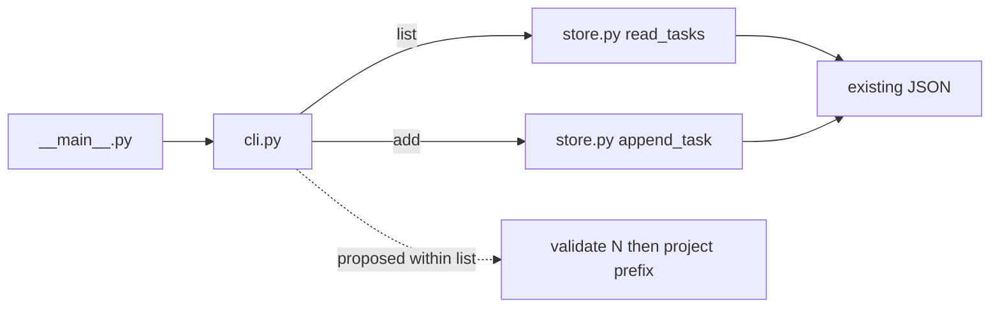

# SPEC-T-014 — ограничить вывод локального списка задач

**Учебный пример.** Проект, его состояние, запрос и источники ниже вымышлены. Это заполненный образец оформления, а не разведка настоящего репозитория, разрешение на реализацию или отчёт о проверках. Все команды — контракт будущей реализации примера, не выполненные здесь действия.

- Record: `specs/T-014-list-limit.md` в условном проекте; этот учебный файл называется `SPEC-EXAMPLE.md`.
- Profile: BROWNFIELD. Version: 1. Status: draft. Approval: pending.
- Roadmap: P2 «Большой список удобно просматривать»; task: T-014 «Необязательный предел вывода».
- Input RECON: встроенный раздел RECON-EXAMPLE ниже.
- Реализация, проверки и интеграция: NOT STARTED / NOT RUN / NOT APPROVED.
- Правила использования: [PROJECT-PROCESS.md](PROJECT-PROCESS.md).

$START_DOCUMENT
PURPOSE: Дать локальному пользователю возможность увидеть первые N задач, сохранив весь список.
SCOPE: Необязательный --limit только для существующей команды list.
KEYWORDS: checklist, CLI, display limit, compatibility, read-only

$START_DOCUMENT_PLAN
$DOCUMENT_PLAN
SECTION_FEATURE:
GOAL Ограничить вывод без изменения хранилища => GOAL_LIMIT
SECTION_SCENARIOS:
USE_CASE Просмотреть две задачи и затем весь список => CASE_LIMIT
$END_DOCUMENT_PLAN

$START_SECTION_FEATURE
$START_ARTIFACT_GOAL_LIMIT
TYPE: GOAL
KEYWORDS: list, prefix, validation, persistence

$START_CONTRACT
PURPOSE: Сократить вывод длинного списка без удаления данных.
DESCRIPTION: list с --limit N показывает первые min(N, число задач) элементов; без опции сохраняется прежнее поведение.
RATIONALE: Для этого этапа достаточно ограничения показа; пагинация и изменение формата хранения не нужны.
ACCEPTANCE_CRITERIA: AC-1–AC-8 ниже: поведение, ошибки, регрессия, область правок, реальная команда и форма данных.
$END_CONTRACT

$START_BODY
## Done when

- Выполнены AC-1–AC-8 на идентифицированном состоянии реализации; сохранены команды, вывод и ограничения проверок.
- Реальная команда показывает нужный префикс, а следующий запуск без опции показывает весь исходный список.
- Результат готов к отдельному решению об интеграции. Факт завершения реализации не означает merge.

## Stop and ask when

- Требуются изменение формата хранения, защищённой сигнатуры, новая зависимость или правка вне MAY EDIT.
- Появилось требование пагинации, фильтрации, иной обработки ошибок или записи данных командой list.
- Выявлено противоречие пользовательского намерения, не разрешённое текущим согласованием.

Отсутствие требуемых доказательств блокирует утверждение о выполнении AC. Само по себе оно не даёт права ослабить критерий.

## Context / Input RECON — RECON-EXAMPLE

Условная база: snapshot `EXAMPLE-BASE-1`. Это символическое имя учебного состояния, не настоящий commit/hash. В реальной спеке здесь должен быть настоящий HEAD и идентичность незакоммиченных входов, а наблюдения ниже сопровождались бы источниками/выводом команд.

| Область | Условно установленное исходное состояние | Источник в учебном проекте |
|---|---|---|
| Запрос | «Хочу видеть первые N задач, но сохранять весь список» | Условный brief T-014; правило R-1 |
| Решение | Хранилище и существующие команды сохраняются; допускается только добавление опции в help | Условные ограничения T-014; правило R-2. Реальное согласование этой спеки пока pending |
| Вход | `python3 -m checklist --store PATH list`; команда add уже существует | `checklist/__main__.py`, `checklist/cli.py`, README |
| Производитель | `read_tasks(path)` читает список; `append_task(path, text)` используется только add | `checklist/store.py` |
| Формат | UTF-8 JSON: `{"tasks": ["Tea", "Bread", "Rice"]}`; порядок и дубликаты значимы | `tests/fixtures/checklist.json`, store |
| Пустое состояние | Отсутствующий файл: list выводит `No tasks\n`, exit 0, файл не создаёт | cli, `tests/test_cli.py` |
| Регрессия | `tests/test_store.py` и все существующие сценарии `tests/test_cli.py` | Исходные байты/перечень сценариев должны быть записаны с настоящей базой до реализации |
| Стек | Уже выбранный проектом Python; сторонних зависимостей нет | README и конфигурация проекта |

Никаких реальных файлов или тестов для этих утверждений здесь не читалось. В настоящем проекте неполный Input RECON удерживает зависимые выводы. В учебных условиях БД, удалённых сервисов, LLM и настроенного генератора карты кода нет; поэтому соответствующие проверки неприменимы. Если они есть в реальном проекте, этот вывод переносить нельзя.

## What we add

Публичная команда: `python3 -m checklist --store PATH list --limit N`.

- N — строка из одной или нескольких ASCII-цифр `0`–`9`, её целое значение больше нуля. Ведущие нули допустимы: `02` означает 2. Знак `+`, пробелы, дробь, отрицательное число и ноль недопустимы.
- Для валидного N выводятся первые min(N, длина списка) задач в исходном порядке, каждая с `\n`; stderr пуст, exit 0.
- Без --limit выводятся все задачи с прежними stdout/stderr/exit. При N больше длины тоже выводятся все.
- Пустой список или отсутствующий файл при валидном N: `No tasks\n`, exit 0. Отсутствующий файл не создаётся.
- Невалидное значение: stdout пуст, stderr ровно `limit must be a positive integer\n`, exit 2; отклонить до чтения хранилища.
- Отсутствующее значение у --limit и повтор опции: штатная ошибка парсера, exit 2, без доступа к хранилищу; точный текст штатной ошибки не закрепляется.
- Опция не добавляется в add. `add --limit 2` отвергается с прежней штатной ошибкой парсера, exit 2.
- Команда list никогда не создаёт и не перезаписывает хранилище. Формат и поведение ошибок чтения остаются прежними.

## Business Requirements

- **BR-1 — совместимость (R-2).** Прежние add/list, JSON, порядок/дубликаты, обработка отсутствующего/повреждённого файла, `read_tasks(path)`, `append_task(path, text)` и `main(argv=None)` сохраняют поведение. Единственное предлагаемое исключение: help команды list содержит новую опцию; допускается фактическое обновление соответствующего ожидания теста. Это исключение входит в предмет согласования, пока не разрешено.
- **BR-2 — полезный результат (R-1).** Валидный предел показывает только требуемый префикс; отсутствие опции показывает весь список.
- **BR-3 — отклонение неверного ввода (R-1, детализация в этой draft-спеке).** Невалидное значение отвергается предсказуемо до доступа к данным; отсутствующее/повторное значение обрабатывается по контракту выше.
- **BR-4 — сохранность (R-1/R-2).** Любой вызов list оставляет существующие байты неизменными и не создаёт отсутствующий файл.
- **BR-5 — документированное использование (детализация R-1).** README описывает команду, значение по умолчанию, допустимое N и ошибки. Предлагаемые детализации входят в версию на согласование; они не выдаются за дословные слова владельца.

## Boundaries

**Always do:** сохранять порядок, дубликаты и данные; проверять отрицательные случаи и существующие сценарии; сверять полный список правок с назначением MAY EDIT; сохранять доказательства.

**Ask first:** расширение перечисленных контрактов/путей, новая зависимость, изменение защиты; отдельно — интеграция результата. Пока approval pending, разрешена подготовка спеки, реализация не разрешена.

**Never do:** обрезать или мигрировать JSON ради показа; удалять старые проверки ради зелёного результата; представлять пример как фактический RECON или выполненную проверку; писать в пользовательское хранилище во время probe.

## Expected Architecture

Условно существующие связи: launcher → CLI; CLI → reader для list; CLI → appender для add. Reader/appender работают с одним форматом. Изменение вставляется внутри обработки list: проверка опции до reader, выбор префикса после reader, затем прежний вывод.

Сплошные связи — учебная база; пунктир — предложение. Это не граф, проверенный или замороженный реальным владельцем. Защита store и сигнатур предлагается как часть согласования этой спеки; после него исполнитель сохраняет эти границы. Конкретные локальные функции и алгоритм выбирает исполнитель. Отдельный DevPlan и роли агентов не требуются данным переносимым контрактом.

## Scope

**MAY EDIT после согласования:**

- `checklist/cli.py` — опция только для list, её валидация и выбор префикса.
- `tests/test_cli.py` — новые случаи и только фактическая правка help-ожидания из BR-1.
- `tests/test_limit.py` — поведенческие, регрессионные и реальные процессные проверки новой опции.
- `tests/test_guide.md` — связи BR/AC с тестами и probe; создать, если это новый файл данного среза.
- `scripts/probe_limit.py` — будущий воспроизводимый probe в собственном временном каталоге.
- `README.md` — использование новой опции с сохранением остальных инструкций.
- `notes/T-014-result.md` — будущий отчёт об исполнении AC и отклонениях.

**DO NOT TOUCH:** `checklist/store.py`, `checklist/__main__.py`, `tests/test_store.py`, `tests/fixtures/checklist.json` — прежние контракты, входная фикстура и независимая регрессионная база; три сигнатуры BR-1; сама согласованная версия спеки — изменения только через новое решение.

**Excluded:** пагинация, фильтры, сортировка, GUI, сеть, изменение хранения, новые зависимости. **Deferred:** пагинация возвращается после принятого T-014 и отдельного решения о навигации.

Текущие TASKS/ROADMAP/HANDOFF обновляет их назначенный хранитель по результатам. Реализующий исполнитель возвращает ему данные; эта оговорка не даёт исполнителю неограниченных прав на процессные файлы.

## Acceptance Criteria и трассировка

Каждая строка — будущая обязанность, текущий результат всех строк **NOT RUN**.

| ID | Требования | Метод / вход | Ожидаемый результат |
|---|---|---|---|
| AC-1 | BR-2, BR-4 | Tea/Bread/Rice; реальные list с N=2, N=9, N=02 и без опции | stdout соответственно `Tea\nBread\n`, весь список, две задачи, весь список; stderr пуст; exit 0; байты не изменены |
| AC-2 | BR-2, BR-4 | Валидный N на отсутствующем файле и `{"tasks":[]}` | `No tasks\n`, stderr пуст, exit 0; отсутствующий файл не создан, существующий неизменен |
| AC-3 | BR-3, BR-4 | N: 0, -1, abc, 1.5, +2, строка с пробелом | stdout пуст; точный stderr из контракта; exit 2; reader не вызван, байты неизменны |
| AC-4 | BR-1, BR-3, BR-4 | Пропуск значения, повтор --limit, передача опции в add | Ошибка соответствующего парсера, exit 2, без доступа к хранилищу |
| AC-5 | BR-1 | `python3 -m unittest discover -s tests` | Сохранились все исходные сценарии store/CLI, включая повреждённые данные, порядок и дубликаты; прошли новые случаи. Из старых ожиданий меняется только согласованный help |
| AC-6 | BR-1–BR-5, Scope | Сравнение базы со всеми staged/unstaged/untracked правками; чтение README | Все пути/назначения в MAY EDIT, защищённые байты/сигнатуры/связи сохранены; README полностью передаёт синтаксис, default и ошибки; зависимостей не добавлено |
| AC-7 — REAL-PATH | BR-1–BR-4 | Будущий `python3 scripts/probe_limit.py` запускает действительный модуль в дочерних процессах | Проверены реальные stdout/stderr/exit и байты до/после; probe завершает все сценарии ниже, печатает `GREEN\n` и exit 0; при расхождении — ненулевой exit |
| AC-8 — REAL-SHAPE | BR-1, BR-2, BR-4 | Копия существующего `tests/fixtures/checklist.json` в probe-owned temp; реальный list --limit 2 | Префикс совпадает с первыми двумя записями фикстуры; копия и оригинал не изменены. Синтетические плохие данные дополняют этот случай |

Реальный reader может быть заменён наблюдаемой заглушкой в отдельном тесте AC-3/4 для доказательства отсутствия вызова. Такая проверка не заменяет процессные AC-7/8. Число тестов заранее не закрепляется; сравниваются конкретные исходные сценарии.

## Delivery / Live Probe

- **Среда:** существующий выбранный Python и checkout условного проекта. Сначала фиксируется фактическая версия интерпретатора; новая зависимость не устанавливается.
- **Место результата:** stdout/stderr дочерних процессов и копии данных в принадлежащем probe временном каталоге. Сеть, credentials и пользовательские файлы не используются.
- **Команда:** `python3 scripts/probe_limit.py` — требуемый будущий артефакт, пока не существует в рамках этого примера.
- **Предпосылки:** реализация и probe созданы, исходная фикстура доступна, разрешён запуск локальных процессов и запись во временный каталог.
- **Сценарий:** скопировать фикстуру; list с пределом 2 → 9 → 02 → без предела → невалидный 0. Затем проверить пустой и отсутствующий store, пропуск/повтор опции и запрет для add. После каждого шага сравнить поток/exit и сохранность/отсутствие файла. Остальные лексические ошибки покрываются AC-3.
- **Успех/провал:** как в AC-7; пропуск обязательного сценария не является успехом.
- **Доказательство:** в `notes/T-014-result.md` сохранить настоящую идентичность кандидата и входов, версию Python, команду, вывод, exit, сравнение файлов, результаты каждой строки AC и список отклонений.

Настроенная карта кода, LLM/PI, удалённая доставка и БД неприменимы только в заданной учебной базе. Отложенных проверок по проектному замыслу нет; все ещё невыполненные AC остаются NOT RUN, а не «зачтены позже».

## Risks / Deficiencies / Deviations

Риск записи при list снимается проверкой байтов и отсутствия файла. Риск случайной перестановки/потери дубликатов — регрессией BR-1 и выбором префикса без сортировки. Парсер может принять отрицательное значение за опцию: AC-3 требует именно оговорённый stderr, поэтому реализация должна это проверить.

**SPEC_DEFICIENCY EXAMPLE-BASE:** нет реального репозитория, снимка и разведки. Источник: учебная природа этого файла; затронуты Context и будущие проверки AC-5/6/8. Интерпретация: использовать только как образец формы, заменить учебную базу настоящими наблюдениями перед передачей на реальную реализацию. Это не разрешение считать разведку пройденной.

**Approval:** pending для версии 1, включая предложенные детали BR-3/BR-5, исключение help и границы. Настоящего решения владельца здесь нет. Результат реализации и интеграция ещё не существуют.

**Deviations:** реализация не начата; раздел исполнителя пока pending. В будущем отчёте требуется полный перечень отклонений или явное `none`; обнаруженный пробел не разрешает тихо изменить согласованные BR/AC.
$END_BODY

$START_LINKS
IMPLEMENTS: (none)
IMPACTS: CASE_LIMIT
REQUIRES: (none)
$END_LINKS
$END_ARTIFACT_GOAL_LIMIT
$END_SECTION_FEATURE

$START_SECTION_SCENARIOS
$START_ARTIFACT_CASE_LIMIT
TYPE: USE_CASE
KEYWORDS: local user, inspect, prefix, unchanged store

$START_CONTRACT
PURPOSE: Показать пользу ограничения без потери полного списка.
DESCRIPTION: Локальный пользователь → запускает list --limit 2 и затем list → видит сначала две задачи, затем весь список.
RATIONALE: Повторный запуск без опции обнаруживает ошибочную обрезку хранения.
ACCEPTANCE_CRITERIA: AC-1, AC-7 и AC-8 подтверждают вывод, отдельные процессы и неизменность данных.
$END_CONTRACT

$START_BODY
На собственной копии Tea/Bread/Rice пользователь запускает `python3 -m checklist --store PATH list --limit 2`: получает Tea и Bread. Новый процесс с тем же PATH и командой list без опции возвращает Tea, Bread и Rice. После каждого запуска байты файла равны исходным. Неверный предел 0 возвращает оговорённую ошибку и сохраняет возможность следующего полного чтения.
$END_BODY

$START_LINKS
IMPLEMENTS: GOAL_LIMIT
IMPACTS: (none)
REQUIRES: GOAL_LIMIT
$END_LINKS
$END_ARTIFACT_CASE_LIMIT
$END_SECTION_SCENARIOS
$END_DOCUMENT
